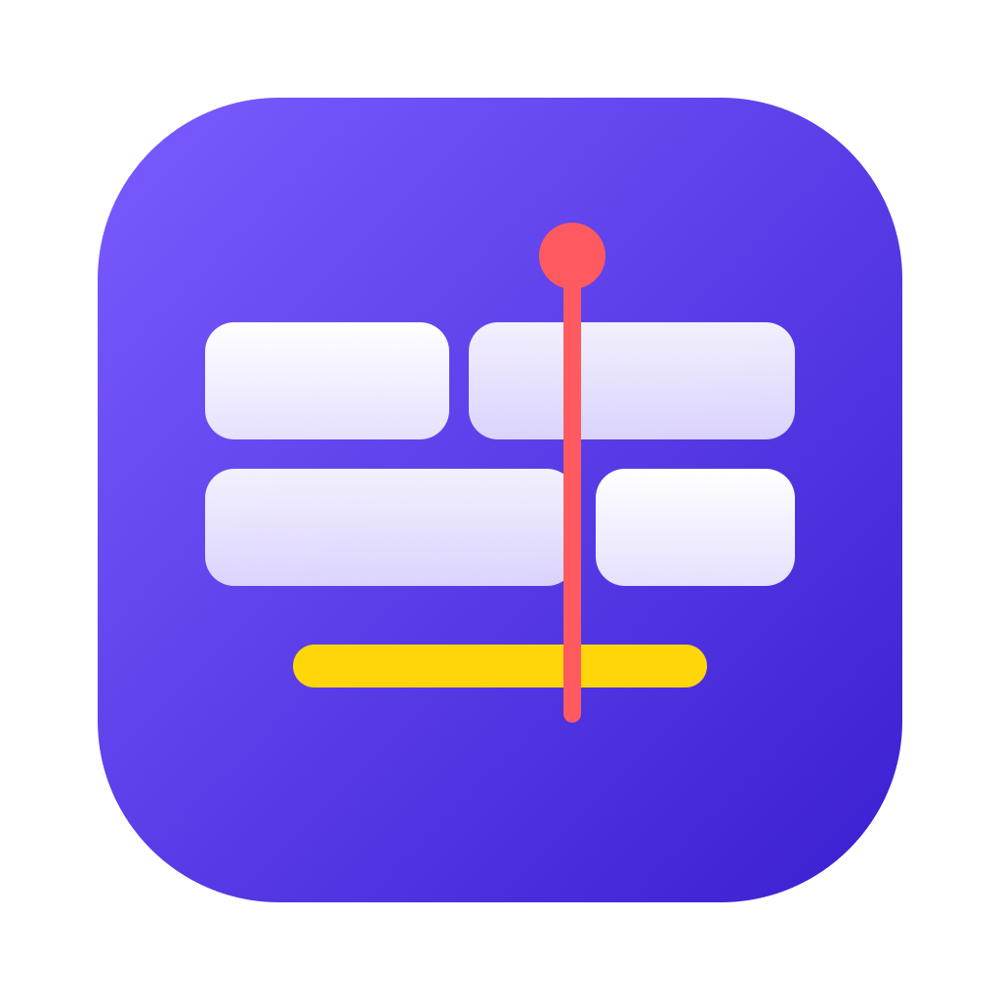

# CueCut

Seslendirme + SRT + numaralı görsel/video dosyalarından hazır video üreten **ücretsiz ve çevrimdışı** masaüstü uygulaması (macOS ve Windows).

SRT'nin 1. bloğu `01` dosyasına, 2. bloğu `02` dosyasına oturur; sahne süreleri altyazı zamanlarına kilitlenir. Kamera hareketi, geçiş, renk tonu ve altyazı stili seçilir, video MP4 veya WebM olarak dışa aktarılır. Hesap, sunucu ya da internet bağlantısı gerekmez.

## İndir

**[Son sürüm →](https://github.com/meerimo/cuecut-releases/releases/latest)**

| Sistem | Dosya |
|---|---|
| macOS – Apple Silicon (M1 ve sonrası) | `CueCut-<sürüm>-mac-arm64.dmg` |
| macOS – Intel | `CueCut-<sürüm>-mac-x64.dmg` |
| Windows 10/11 (çoğu bilgisayar) | `CueCut-<sürüm>-win-x64.exe` |
| Windows on ARM | `CueCut-<sürüm>-win-arm64.exe` |

### İlk açılış

Uygulama ücretli geliştirici sertifikasıyla imzalanmadığı için ilk açılışta bir uyarı çıkar:

- **macOS:** `.dmg`'yi açıp CueCut'ı Applications klasörüne sürükle. "Geliştirici doğrulanamadı" uyarısında uygulamaya **sağ tık → Aç**. macOS 15 ve sonrasında: Sistem Ayarları → Gizlilik ve Güvenlik → **Yine de Aç**.
- **Windows:** SmartScreen uyarısında **Ek bilgi → Yine de çalıştır**.

## Özellikler

- SRT'ye kilitli sahneler; `03-05.png` gibi aralıkla bir görsel birden fazla bloğa yayılır
- Canlı önizleme, sürükleyerek sıra değiştirme, sahne bazında ayar
- 9 kamera hareketi, 8 geçiş, 5 renk tonu
- 7 altyazı stili (karaoke, kelime kelime, vurgu kutusu, Shorts iri kelimeler…)
- MP4 (H.264 + AAC) / WebM, 720p–4K, 24–60 fps, gerçek zamandan hızlı dışa aktarım
- Proje kaydet/aç (`.cuecut`), Türkçe ve İngilizce arayüz

Bu depo yalnızca kurulum dosyalarını barındırır. Uygulama açılışta (isteğe bağlı) buradaki son sürümü denetler.
